  

  <a href="https://yacinbenkacem.me/">Portfolio</a> ·
  <a href="https://www.linkedin.com/in/yacin-ben-kacem/">LinkedIn</a> ·
  <a href="mailto:yacinbenkacem19@gmail.com">Email</a>

I'm a final-year **Software Engineering student at ENISO**, based in Tunisia. I build AI agents and RAG systems with access control, grounded answers, and workflows that recover when things go wrong.

My focus: **secure retrieval, agent orchestration, and evaluation**. Most recently, I built a role-aware knowledge assistant at White Cape Technologies.

## Selected work

### Role-Aware RAG Knowledge Assistant

An internal assistant for company knowledge and codebases. A LangGraph workflow retrieves, reranks, and streams cited answers, with permissions enforced inside retrieval and inference running locally.

Evaluation drove the design: **46% less retrieved context while preserving direct-evidence recall** on the evaluation set, and **zero authorization violations across 280 audited retrievals**.

**Built with:** LangGraph, FastAPI, Qdrant, Ollama, Keycloak · White Cape Technologies, 2026

### [UX Insight Platform](https://github.com/YACINBK/ux-insight-platform)

Turns screenshots and interaction data into evidence-backed UX reports. Combines UI detection, OCR, and RAG, with provider-agnostic inference and asynchronous jobs behind a secure gateway.

**Built with:** Angular, Spring Boot, FastAPI, ChromaDB, Keycloak · White Cape Technologies, 2025

### [Agentic Video Production Pipeline](https://github.com/YACINBK/content-automation)

Automates video production end to end. Checks completed work before each step, reformulates rejected generations, and resumes after interruption. Browser automation uses selector fallbacks and retries.

**Built with:** Python, Playwright, FFmpeg, Whisper, voice-cloning TTS

## What I work with

- **Agents & retrieval:** LangGraph, MCP, LiteLLM, Ollama, Qdrant, retrieval evaluation
- **Security & backend:** Python, FastAPI, Spring Boot, Keycloak, OAuth 2.0 / OIDC, RBAC
- **Data & delivery:** PostgreSQL, Redis, Celery, Docker, contract-driven testing

Also building MCP tools and planner–generator–evaluator workflows for my daily development work.

## GitHub activity

Public metrics refresh every six hours via [GitHub Actions](https://github.com/YACINBK/YACINBK/actions/workflows/github-stats.yml); the panel shows the last successful update. [Contribution history](https://github.com/YACINBK#year-list-container).

---

Interested in secure AI systems or agentic automation? [Let's talk](mailto:yacinbenkacem19@gmail.com).
