

  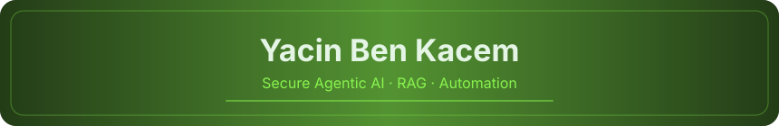

 

  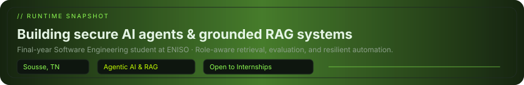

 

  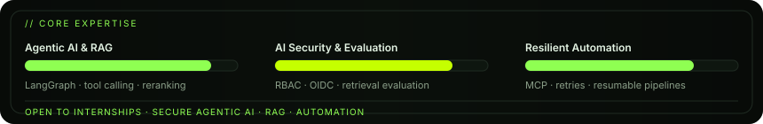

 

  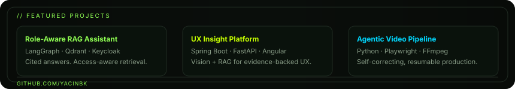

<!-- Each complete card is its own link; SVG-internal links do not work in README images. -->

  <a href="https://github.com/YACINBK/Agentic_Rag_Assistant"></a>
  <a href="https://github.com/YACINBK/ux-insight-platform"></a>
  <a href="https://github.com/YACINBK/content-automation"></a>

<strong>Inside the projects — what I built and why it matters</strong>

**[Secure Role-Aware RAG Assistant](https://github.com/YACINBK/Agentic_Rag_Assistant) · White Cape Technologies, 2026**

An internal assistant for company knowledge and codebases. A nine-node LangGraph workflow retrieves, reranks, checks relevance, and streams cited answers. Keycloak permissions are enforced inside retrieval, and inference runs locally with Ollama. Evaluation showed **zero authorization violations across 280 audited retrievals** and **46% less context while preserving direct-evidence recall** on the evaluation set. Probing the faithfulness check also exposed a lexical-overlap blind spot, captured as a regression test.

**[UX Insight Platform](https://github.com/YACINBK/ux-insight-platform) · White Cape Technologies, 2025**

Turns screenshots and interaction data into evidence-backed UX reports. Combines UI detection, OCR, and ChromaDB retrieval with provider-agnostic inference. Angular, Spring Boot, and FastAPI handle the interface and services, with asynchronous jobs and Keycloak authentication.

**[Agentic Video Production Pipeline](https://github.com/YACINBK/content-automation) · 2026**

Runs video production end to end with Python, Playwright, FFmpeg, Whisper, and voice-cloning TTS. Inspects completed work before each step, reformulates rejected generations, and resumes after interruption. Selector fallbacks and retries make browser steps more resilient.

**Also building:** MCP tools and planner–generator–evaluator workflows for daily development, plus [AI image vectorization](https://github.com/YACINBK/image-vectorization) and [QuickFlow](https://github.com/TaherBenAfia/quickflow).

 

  

 

  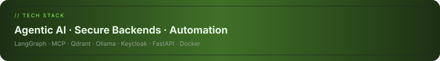

  

  

  

 

  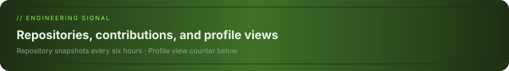

  
  
  <!-- Keep this counter remote: saving it in the scheduled SVGs would count workflow fetches instead of README image loads. -->
  

  

  <a href="https://github.com/YACINBK#year-list-container">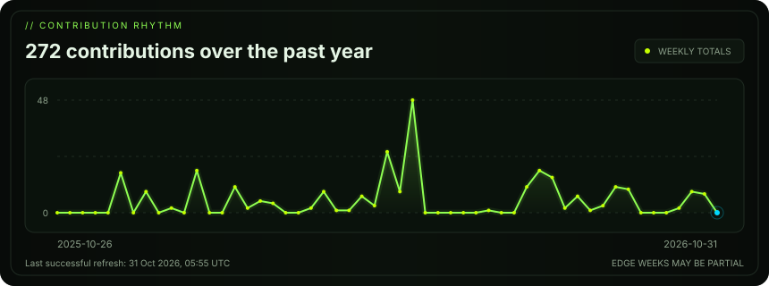</a>

 

  <a href="mailto:yacinbenkacem19@gmail.com">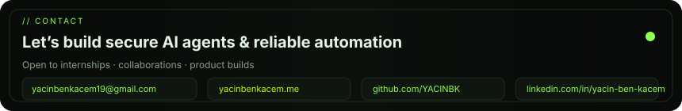</a>

